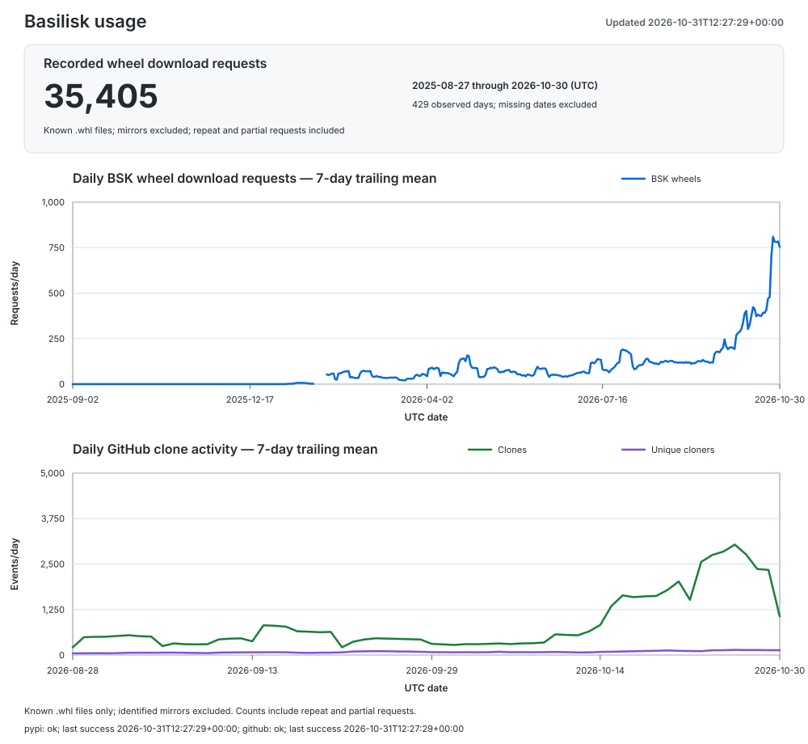

# Basilisk usage metrics

Updated 2026-11-01T13:23:08+00:00.
Collection status: **complete**.

| Source | Status | Last successful collection (UTC) | Latest error |
|---|---|---|---|
| pypi | ok | 2026-11-01T13:23:08+00:00 | none |
| github | ok | 2026-11-01T13:23:08+00:00 | none |

Failed sources retain their previous observations; they are not new daily snapshots.
Collection time does not guarantee that the upstream dataset is current; see coverage dates.

| Metric | Count | Coverage |
|---|---:|---|
| Recorded wheel download requests | 35,627 | 2025-08-27 through 2026-10-31; 430 observed days |
| PyPI downloads excluding known mirrors | 55,129 | 2025-08-27 through 2026-10-31 |
| PyPI downloads made by `pip` | 20,777 | 2025-08-27 through 2026-10-31 |
| PyPI downloads made by `uv` | 7,849 | 2025-08-27 through 2026-10-31 |
| Total PyPI downloads made by `pip` or `uv` | 28,626 | 2025-08-27 through 2026-10-31; 430 observed days |
| GitHub clone events retained by this tracker | 57,432 | 2026-08-22 through 2026-10-31 |
| GitHub clones in the last successful API window | 24,234 | 2026-10-18 through 2026-10-31 |
| Unique GitHub cloners in the last successful API window | 1,316 | 2026-10-18 through 2026-10-31 |
| Last observed GitHub forks | 144 | snapshot |
| GitHub release-asset downloads | 0 | cumulative snapshot |

`metrics.csv` contains the daily history and `summary.json` contains the latest
machine-readable totals. `usage.svg` contains the wheel-request total and plotted seven-day trends.

## Interpretation

- The wheel-request total requires a known filename ending in `.whl` and excludes
  identified mirrors. It includes all other clients, including browsers, Poetry,
  pip, uv, scripts, and unidentified clients. Source archives, metadata files,
  signatures, and records without filenames are excluded from this total.
  The BSK wheels plot uses the same daily counts, shown as seven-day trailing means.
  Repeat and partial requests may be included; full-file transfers are not verified.
  Missing dates and legacy dates awaiting wheel backfill are excluded, not counted as zero.
- PyPI counts are file-download events, not verified installations or unique users.
  The `pip` and `uv` counts select records identified with those installers.
  Their combined total sums only dates with both counts available; missing dates
  and legacy dates awaiting uv backfill are excluded, not treated as zero.
- Both the non-mirror distribution counts and wheel requests exclude `bandersnatch`, `z3c.pypimirror`,
  `Artifactory`, and `devpi` (the PyPI Stats mirror list), plus the Nexus repository cache.
  The broader non-mirror counts include pip, uv, and other clients; do not add them to installer counts.
- The broader distribution counts exclude identified non-distribution files, including `.metadata` sidecars.
  Older records without filenames remain and may include metadata requests.
  PyPI changed its logging on 2026-08-24; historical counts are not fully comparable.
  Retained PyPI counting policy: `distribution_files_or_unknown_filename`.
  A successful PyPI refresh applies the revised filter to returned historical dates.
- Plots require seven consecutive observed days. Explicit zeros count; absent dates
  remain unknown and break the plotted series. The latest reported day may be partial.
- GitHub exposes clone traffic for only the latest 14 days. The tracker preserves
  those daily counts; gaps longer than 14 days cannot be recovered.
- Daily unique-cloner values cannot be summed into an all-time unique-user count.
- Forks are currently existing forks, not a lifetime count of every fork ever made.
- Release downloads cover uploaded release assets only. GitHub provides no download
  count for its automatically generated source ZIP and tar archives.

The data comes from the public PyPI dataset through
[ClickPy](https://clickpy.clickhouse.com/) and from the
[GitHub REST API](https://docs.github.com/en/rest/metrics/traffic).
